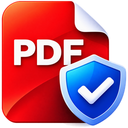
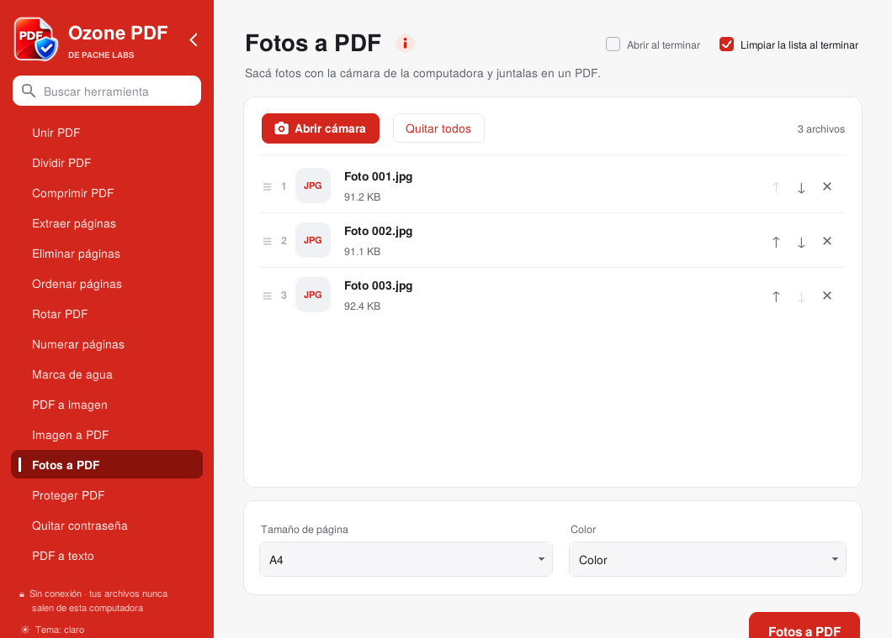
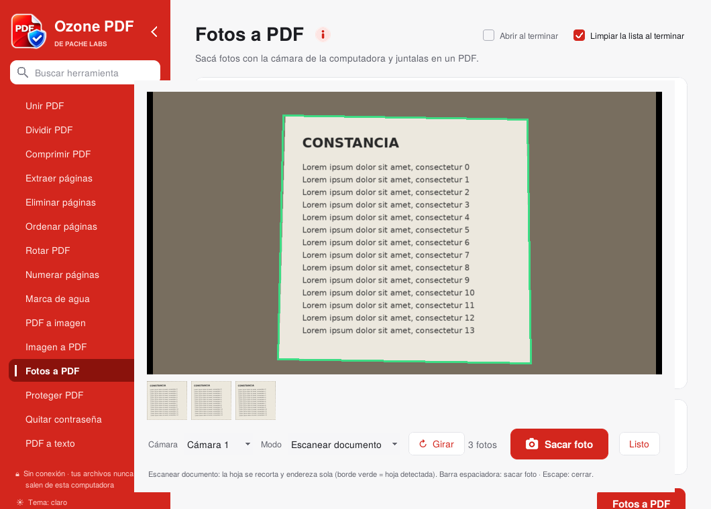
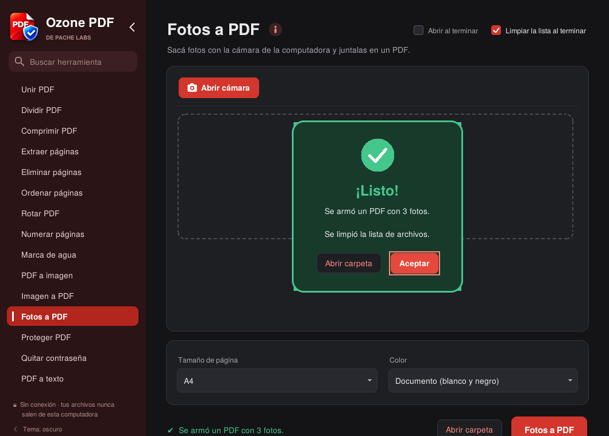

  

<h1 align="center">Ozone PDF</h1>

<b>Herramientas PDF gratis que funcionan sin internet.</b> 
Tus documentos nunca salen de tu computadora.

Un programa de <b>Pache Labs</b>.

  

## Por qué lo hice

Vi a muchas personas que trabajan con información sensible, en distintos rubros, usar
páginas de internet para unir o achicar un PDF: contratos, recibos de sueldo y DNI
terminaban subidos a sitios que nadie sabe quién maneja. Ozone PDF hace lo mismo, pero
todo pasa en tu computadora:

- Funciona sin internet. El programa no tiene con qué conectarse, y el instalador además
  le bloquea la salida en el firewall de Windows.
- Es gratis, no tiene publicidad y no pide cuenta.
- El código es abierto (AGPL-3.0), así que cualquiera puede revisarlo.
- Nunca toca tu archivo original: siempre guarda una copia nueva.
- Los PDF que genera salen sin autor, adjuntos ni datos ocultos del original.

## Herramientas

| | | |
|---|---|---|
| Unir PDF | Dividir PDF (páginas, rangos o MB) | Comprimir PDF |
| Extraer páginas | Eliminar páginas | Ordenar páginas |
| Rotar PDF | Numerar páginas | Marca de agua |
| PDF a imagen (JPG/PNG) | Imagen a PDF | **Fotos a PDF** (escáner con la cámara) |
| Proteger con contraseña (AES-256) | Quitar contraseña | PDF a texto |

**Fotos a PDF** usa la cámara de la computadora como escáner. En el modo
*Escanear documento* detecta la hoja, la recorta y la endereza sola, y la opción
*Documento* deja el papel blanco y el texto nítido.

  
  

También tiene buscador de herramientas (Ctrl+F), modo claro, oscuro o automático,
menú que se puede colapsar y arrastrar y soltar archivos.

**Idiomas:** español, inglés, alemán, chino simplificado, japonés y ruso. La primera vez
usa el idioma de Windows, y se cambia desde "Idioma" en el pie del menú.

## Descargar

Andá a **[Releases](../../releases)** y bajá el instalador:

- `Instalar_Ozone_PDF_X.Y.Z.exe`: doble clic y listo (Windows 10/11, 64 bits).
- `Ozone_PDF_X.Y.Z.msi`: para que un área de sistemas lo instale en muchas PCs (GPO, Intune, SCCM).

No hace falta tener Python ni nada extra instalado.

## Compilar desde el código

En Windows, con Python 3.12 (64 bits) e Inno Setup 6.3 o superior, ejecutá
`CREAR_INSTALADOR.bat`. El script:

- arma un entorno limpio e instala las dependencias con versión y huella SHA-256 fijas (`requirements.txt`);
- compila el programa **sin los módulos de red de Python**;
- corre una autoprueba de las 15 herramientas sobre el ejecutable final;
- genera el instalador.

Para el `.msi`, ejecutá después `CREAR_MSI.bat` (necesita WiX Toolset 3).
Para probar sin compilar, usá `1_probar.bat`. Los detalles técnicos y de seguridad
están en [INFORME_SEGURIDAD.txt](INFORME_SEGURIDAD.txt).

## Licencia

Ozone PDF es software libre bajo la [GNU AGPL-3.0](LICENSE.txt).
© 2026 Nicolás Emanuel Pacheco (Pache Labs).

Las traducciones están en `traducciones.py`: si ves algo mal traducido, avisame.

Usa PyMuPDF/MuPDF (AGPL-3.0), Pillow, OpenCV, NumPy, tkinterdnd2 y Python, cada uno
con su licencia (ver [LICENCIAS.txt](LICENCIAS.txt)).

## Apoyar el proyecto

Ozone PDF es y va a seguir siendo gratis. Si te sirvió y querés ayudar a que
Pache Labs haga más herramientas como esta:

- Invitame un cafecito: https://cafecito.app/pachelabs
- Dejale una estrella al repositorio y compartilo con quien lo necesite.
- Contame problemas o ideas en [Issues](../../issues) o a pache.labs@gmail.com.
